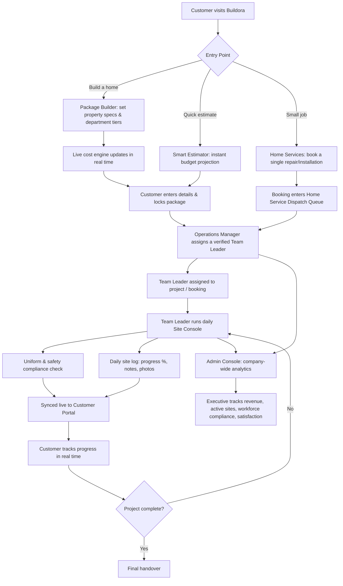

# Buildora

**One Team. One Vision. One Perfect Home.**

An end-to-end construction and home services platform that replaces the fragmented, open contractor-marketplace model with a single verified in-house workforce, covering everything from smart cost estimation and live package customization to on-site supervision, workforce dispatch, and executive-level company analytics.

> **Disclaimer:** Buildora is a concept platform with demo data. Company figures, ratings, and warranty details are illustrative and do not represent a real business.

---

## Live Demo

**https://buildora-ten.vercel.app/**

Use the role switcher in the app to explore the **Customer**, **Team Leader**, **Operations Manager**, and **Admin** views.

---

## Why This Is Different

Most home-building platforms are just marketplaces. They connect you to independent contractors and step out of the picture. Buildora is not an open worker marketplace. Buildora recruits, equips, verifies, and directly operates its entire workforce under one brand. When a customer hires Buildora, Buildora takes complete ownership of the project, from blueprint to final handover, with one accountable team instead of a patchwork of subcontractors.

**Concept credentials (illustrative):**
- 100% direct-employed staff (no gig-market subcontracting)
- 10,000+ projects delivered
- 25-year structural warranty
- 4.95 / 5 customer audit rating

---

## Features

### For Customers
- **Dynamic Package Builder:** customize a full home build in real time: property type, plot size, built-up area, number of floors, and per-department tier (Basic, Standard, Premium, Elite) for everything from structural design to painting, with a live cost engine that recalculates instantly as selections change
- **Smart Rule-Based Estimator:** an AI-style estimator that uses regional rate cards, specification multipliers, and construction indices to generate an instant, itemized budget projection with over/under-budget warnings
- **On-Demand Home Services:** book standalone repair and installation jobs (plumbing, electrical, painting, carpentry, HVAC, smart home) with transparent upfront pricing and estimated completion time, delivered by uniformed, verified Buildora specialists
- **Assigned Team Leader visibility:** every locked-in project shows its dedicated, verified Team Leader with experience and rating before the customer commits

### For Team Leaders (Site Supervisors)
- **Site Console:** submit daily site logs with activity headlines, supervisor notes, progress percentage, worker count, and site photos, all synced directly to the customer's live view
- **Mandatory safety and uniform compliance checklist:** helmet, high-vis jacket, official T-shirt, and steel-toe shoes verified daily before work begins
- **Single point of contact protocol:** Team Leaders are the customer's one accountable contact, reinforcing the "no unregistered workers" policy

### For Operations Managers
- **Centralized Workforce Dispatch:** assign verified Team Leaders to active construction sites and incoming home-service bookings from one dispatch queue
- **Workforce Directory and Uniform Compliance tracking** across all in-house departments
- **Live project assignment control:** reassign supervisors per project (for example Civil & Masonry, Electrical & Power) with real-time status

### For Admins (Executive Control Panel)
- **Company-wide analytics:** gross contracted value, amount collected, active turnkey sites, verified workforce size, and overall customer satisfaction
- **Department performance metrics:** team leaders, skilled craftsmen, active project count, and audit rating per department (Civil & Masonry, Plumbing & Drainage, Electrical & Power, Painting & Coating, Carpentry & Woodwork, Interior Design, Architecture & Structural, and more)

---

## Screenshots

### Landing Page
Verified-workforce positioning, trust stats, and three entry points: Build My Home, Book a Service, Get Free Estimate.


### Dynamic Package Builder: Live Cost Engine
Every slider and tier change recalculates the estimated investment, cost-factor breakdown, and materials/labour/management split instantly.


### Package Builder: Department Tiers and Package Lock-In
Per-department tier selection (Basic, Standard, Premium, Elite) with material brand transparency, assigned Team Leader, and final customer detail capture to lock the package.


### Smart Cost Estimator
Instant projected total cost, itemized cost factors, and automatic budget-overage warnings.


### On-Demand Home Services
Standalone repair and installation booking with category filters, service inclusions, starting price, and estimated turnaround time.


### Team Leader: Site Console
Daily site log submission with a safety compliance checklist, synced live to the customer.


### Operations Manager: Workforce Dispatch
Centralized assignment of Team Leaders to construction projects and home-service bookings.


### Admin: Executive Control Panel
Company-wide financial and workforce analytics, with department-by-department performance and audit ratings.


---

## How It Works: End-to-End Flow



**In short:**
- A customer enters through the Package Builder, Smart Estimator, or Home Services booking flow.
- Once a project or booking is confirmed, the Operations Manager dispatches a verified, in-house Team Leader.
- The Team Leader runs daily operations through the Site Console, logging progress, notes, and mandatory safety and uniform compliance, all synced live to the customer.
- The customer tracks their project in real time until final handover.
- Throughout, the Admin Console aggregates company-wide financials, active sites, department performance, and audit ratings for executive oversight.

---

## Roles and Access

| Role | Portal | Core Responsibility |
|---|---|---|
| **Customer** | Customer Portal | Build or estimate a project, book home services, track live progress |
| **Team Leader** | Site Console | Daily site logging, safety compliance, direct customer communication |
| **Operations Manager** | Workforce Dispatch | Assign Team Leaders to projects and bookings, manage workforce directory |
| **Admin** | Executive Control Panel | Company-wide analytics, department performance, quality compliance oversight |

---

## Tech Stack

| Layer | Technology |
|---|---|
| **Frontend** | React 19, TypeScript, Vite 8 |
| **Styling** | Tailwind CSS 4, custom dark-themed component UI |
| **Estimation Engine** | Rule-based live cost calculation (property type × plot size × tier multipliers × regional rate cards) |
| **State** | React state with localStorage persistence (demo data) |
| **Linting** | Oxlint |
| **Hosting** | Vercel |

---

## Getting Started

```bash
# clone the repo
git clone https://github.com/vanshiiii11/buildora.git
cd buildora

# install dependencies
npm install

# run the app
npm run dev
```

The app runs at `http://localhost:5173`.

```bash
# production build and local preview
npm run build
npm run preview
```

See [DEPLOY.md](DEPLOY.md) for Vercel and Netlify deployment steps.

---

## Roadmap

- [x] Dynamic Package Builder with live multi-department cost engine
- [x] Smart rule-based estimator with budget-overage detection
- [x] Home Services on-demand booking flow
- [x] Team Leader Site Console with safety compliance checklist
- [x] Operations Manager workforce dispatch queue
- [x] Admin executive analytics dashboard
- [ ] Real payment and checkout flow for locked-in packages
- [ ] Push notifications for daily site log updates to customers
- [ ] Role-based authentication and permissions (currently a role switcher, not a secured login)
- [ ] Persistent backend and database (currently demo data in localStorage)
- [ ] Customer-facing project timeline / Gantt view

---

## Author

**Vanshika Motwani**  
B.Tech CSE | VIT Bhopal University  
- Email: [vanshikamotwani120031@gmail.com](mailto:vanshikamotwani120031@gmail.com)  
- LinkedIn: [https://www.linkedin.com/in/vanshika-motwani-2834b632b/](https://www.linkedin.com/in/vanshika-motwani-2834b632b/)  
- GitHub: [https://github.com/vanshiiii11](https://github.com/vanshiiii11)  

---

*Buildora is a concept platform demonstrating an end-to-end, in-house-workforce alternative to the open contractor marketplace model, spanning customer-facing estimation tools, field supervision, workforce dispatch, and executive analytics in one connected system.*
