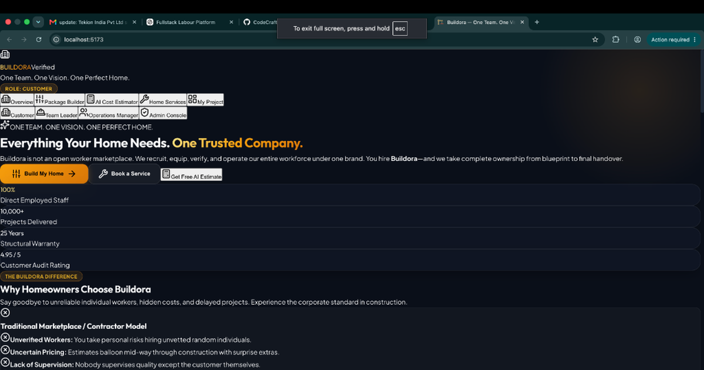
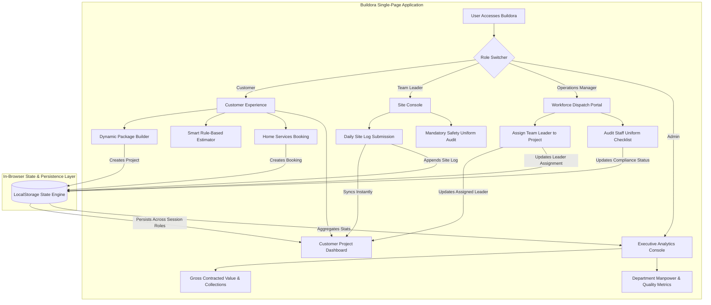

# Buildora 🏗️

> **One Team. One Vision. One Perfect Home.**

An end-to-end turnkey construction and home services platform built with **React 19**, **TypeScript**, and **Tailwind CSS v4**. Unlike contractor listing apps or gig marketplaces, Buildora operates an entirely direct-employed, 100% in-house verified workforce with transparent rule-based cost estimation, live site supervisor logs, and real-time operations dispatch.

---

> [!NOTE]
> **Disclaimer**: This is a concept platform with illustrative demo data. Company figures, project metrics, ratings, and warranty periods are simulated for demonstration purposes.

---

## 🚀 Live Demo

[](https://buildora.vercel.app)

| Portal View | Role | Access | Key Capabilities |
|---|---|---|---|
| **Customer Portal** | Customer | Default View | Dynamic Package Builder, Smart Cost Estimator, On-demand Home Services, Live Project Tracker |
| **Site Console** | Team Leader | Role Switcher | Daily site progress logs, photo uploads, mandatory 5-point uniform checklist |
| **Workforce Dispatch** | Operations Manager | Role Switcher | Team Leader project allocation, workforce directory, live uniform audits |
| **Corporate Analytics** | Admin | Role Switcher | Gross Contracted Value, active turnkey sites, department revenue & audit ratings |

> Switch between all four portals instantly using the interactive **Role Switcher** in the top navigation bar.

---

## 📸 Screenshots



| View | Description |
|---|---|
| **Overview Landing** | Visual brand identity highlighting direct-employed craftsmen vs. freelance brokerages |
| **Dynamic Package Builder** | Real-time calculation engine reacting to plot size, built-up area, floors, and 7 department tiers |
| **Smart Rule-Based Estimator** | Transparent algorithmic estimation using regional rate cards and property spec multipliers |
| **Team Leader Console** | Field log submission with photos, worker counts, weather conditions, and safety compliance |
| **Operations Dispatch** | Real-time technician assignment and uniform verification checklist |
| **Admin Executive Console** | Cross-department operational analytics, gross billing metrics, and satisfaction scores |

---

## 🌟 Key Features

### 1. 📐 Dynamic Package Builder (Live Cost Engine)
- **Live Reactive Calculation**: Automatically recalibrates structure cost, plot site preparation, floor multipliers, and property type factors in real time.
- **7-Department Tier Granularity**: Configure individual tiers (`Basic`, `Standard`, `Premium`, `Elite`) for Architecture, Civil Foundation, Flooring & Marble, Kitchen & Carpentry, Electrical, Plumbing, and Waterproofing.
- **Material Brand Transparency**: Itemizes exact brand specifications per tier (e.g., Tata Tiscon Fe550D, Ultratech Weather Plus, Italian Botticino Marble, Grohe SmartControl).
- **One-Click Project Launch**: Freezes package calculations into a persistent customer project record and assigns a verified Team Leader.

### 2. 🧮 Smart Rule-Based Cost Estimator
- **Transparent Algorithmic Model**: Uses industry rate cards and regional multipliers (Tier-1 Metro, Tier-2 Growth Hub, Suburban) rather than opaque black-box claims.
- **Customizable Property Specs**: Computes costs based on built-up area, plot excavation, bedrooms, bathrooms, floors, and luxury features (e.g., Rooftop Solar, Smart CCTV, Acoustic Glazing).
- **Itemized Distribution**: Visual 56% / 34% / 10% material, labour, and contingency breakdown alongside ROI recommendations.

### 3. 🛠️ On-Demand Home Services Catalog
- **Instant Specialty Bookings**: Single-service repairs and installations across Plumbing, Electrical, Painting, Carpentry, HVAC, and Smart Home Security.
- **Transparent Pricing**: Fixed upfront starting prices with preferred time slot booking.

### 4. 📱 Team Leader Site Console
- **Daily Site Progress Logs**: Site supervisors publish real-time progress percentages, activity headlines, detailed supervisor notes, and photo feeds.
- **Mandatory Safety & Uniform Verification**: Daily sign-off for safety helmet, high-vis jacket, official Buildora T-shirt, steel-toe shoes, and digital QR ID card before log publishing.
- **Live Sync**: Uploaded logs immediately reflect in the Customer Project Dashboard.

### 5. 👥 Operations Workforce Dispatch
- **Centralized Allocation**: Dispatch Team Leaders to pending home builds or home service requests.
- **Uniform Compliance Tracking**: Live audit buttons to toggle and record compliance statuses across all field personnel.

### 6. 📊 Executive Admin Dashboard
- **Financial Analytics**: Real-time Gross Contracted Value, payment collections, active site counts, and customer audit ratings.
- **Department Metrics**: Manpower rosters, active site counts, and audit performance across all trades.

---

## 🏗️ Architecture Flowchart



---

## 💻 Tech Stack

Verified directly from [`package.json`](package.json):

| Technology | Version | Purpose |
|---|---|---|
| **React** | `^19.2.8` | Component architecture and state lifecycle |
| **React DOM** | `^19.2.8` | DOM rendering |
| **TypeScript** | `~6.0.2` | Strict end-to-end type safety |
| **Vite** | `^8.2.0` | Development server and production bundling |
| **Tailwind CSS** | `^4.3.3` | Modern utility-first responsive styling |
| **@tailwindcss/vite** | `^4.3.3` | First-party Vite integration for Tailwind v4 |
| **Lucide React** | `^1.28.0` | UI and status iconography |
| **Canvas Confetti** | `^1.9.4` | Milestone and confirmation celebrations |
| **Oxlint** | `^1.75.0` | High-performance linter |
| **Hosting Platform** | **Vercel** | Edge CDN hosting with zero-config deployment |

---

## 📁 Project Structure

```
buildora/
├── public/
│   ├── favicon.svg             # Branded gold building favicon
│   └── og-image.png            # 1200x630 social preview image
├── src/
│   ├── assets/
│   │   └── hero.png            # Hero visual asset
│   ├── components/
│   │   ├── admin/
│   │   │   └── AdminDashboard.tsx           # Corporate KPI and department metrics
│   │   ├── common/
│   │   │   └── Header.tsx                   # Top navigation with role switcher
│   │   ├── dashboard/
│   │   │   └── CustomerProjectDashboard.tsx # Real-time customer tracking
│   │   ├── estimator/
│   │   │   └── AICostEstimator.tsx          # Smart rule-based estimation engine
│   │   ├── landing/
│   │   │   └── LandingPage.tsx              # Overview and brand identity
│   │   ├── operations/
│   │   │   └── OperationsPortal.tsx         # Dispatch management and roster audit
│   │   ├── package-builder/
│   │   │   └── DynamicPackageBuilder.tsx    # Live specification and cost engine
│   │   ├── services/
│   │   │   └── HomeServicesCatalog.tsx      # On-demand specialty services catalog
│   │   └── team-leader/
│   │       └── TeamLeaderPortal.tsx         # Supervisor site logs & safety check
│   ├── data/
│   │   └── mockData.ts         # Realistic pre-seeded demo entities
│   ├── store/
│   │   └── buildoraContext.tsx # Centralized state provider & calculation logic
│   ├── types/
│   │   └── buildora.ts         # Complete TypeScript domain interfaces
│   ├── App.tsx                 # View router and layout shell
│   ├── index.css               # Design system tokens and glassmorphism utilities
│   └── main.tsx                # Application bootstrap
├── .env.example                # Documented environment template
├── .gitignore                  # Git exclusions (node_modules, dist, .env, .DS_Store)
├── .oxlintrc.json              # Lint rules configuration
├── DEPLOY.md                   # Vercel & Netlify step-by-step deployment guide
├── docs/
│   └── ABOUT.md                # GitHub metadata and LinkedIn announcement
├── index.html                  # SEO, meta tags, and Open Graph configuration
├── package.json                # Project dependencies and build scripts
├── tsconfig.json               # TypeScript configuration
├── vercel.json                 # Vercel deployment rewrites and build settings
└── vite.config.ts              # Vite configuration
```

---

## 🚀 Getting Started

### Prerequisites
- **Node.js**: v18.0.0 or higher
- **npm**: v9.0.0 or higher

### Local Installation

1. **Clone the repository**:
   ```bash
   git clone https://github.com/vanshiiii11/buildora.git
   cd buildora
   ```

2. **Install dependencies**:
   ```bash
   npm install
   ```

3. **Start the local development server**:
   ```bash
   npm run dev
   ```
   Open [http://localhost:5173](http://localhost:5173) in your browser.

4. **Run production build and linter**:
   ```bash
   npm run lint
   npm run build
   npm run preview
   ```

---

## 🌐 Deployment

Buildora is optimized for deployment on **Vercel**:

1. Import repository `vanshiiii11/buildora` into Vercel.
2. Build Command: `npm run build`
3. Output Directory: `dist`
4. Detailed steps and Netlify instructions are documented in [DEPLOY.md](DEPLOY.md).

---

## 👨‍💻 Author

**Vanshi**  
- **GitHub**: [@vanshiiii11](https://github.com/vanshiiii11)
- **LinkedIn**: [Vanshi on LinkedIn](https://www.linkedin.com)

---

*Built with React 19, TypeScript, Vite, and Tailwind CSS v4.*
